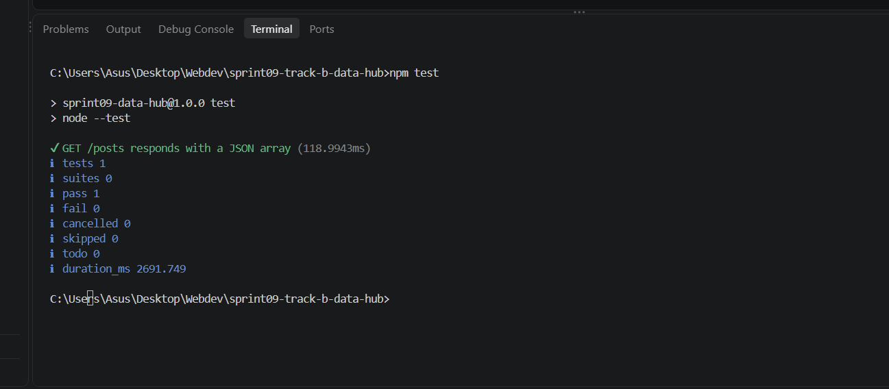
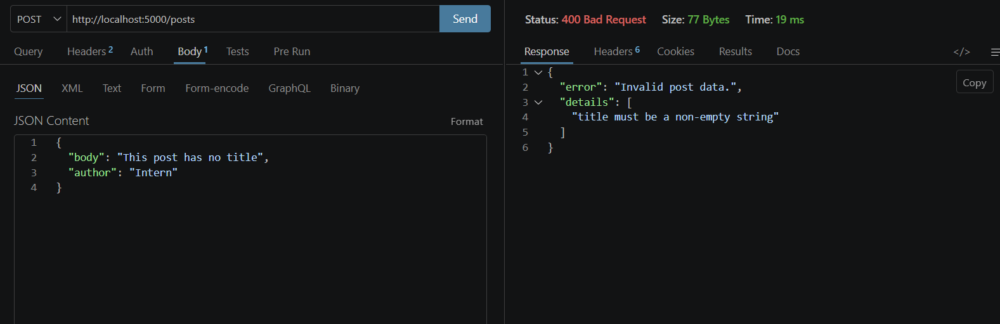

# Data Hub API — Sprint 09, Track B

A backend-only REST API built with Node.js and Express for Sprint 09 Track B. This project covers **Phase 1: Server Initialization & Route Scaffolding** and **Phase 2: In-Memory Database & CRUD Logic**.

## Requirements

- Node.js 18 or newer
- npm
- Postman or Thunder Client




## Run locally

1. Open this folder in a terminal.
2. Install dependencies:

   ```bash
   npm install
   ```

3. Start the server:

   ```bash
   npm run dev
   ```

   Or use `npm start` for a normal start without auto-reload.

The API listens on port `5000` by default. You can set a `PORT` environment variable to use a different port.

Open `http://localhost:5000/` to check that the server is running.

## API routes

| Method | Endpoint | Purpose | Success status |
|---|---|---|---|
| GET | `/posts` | Return all posts | 200 |
| GET | `/posts/:id` | Return one post | 200 |
| POST | `/posts` | Create a post | 201 |
| PUT | `/posts/:id` | Update a post | 200 |
| DELETE | `/posts/:id` | Delete a post | 200 |

Example post:

```json
{
  "id": 1,
  "title": "Learning Express",
  "body": "A short post body.",
  "author": "Intern",
  "createdAt": "2026-10-09T06:00:00.000Z"
}
```

The ID and timestamp are generated by the server.

## Test with  Thunder Client

Use `http://localhost:5000` as the base URL. For JSON requests, set `Content-Type: application/json`.

### 1. Check the server

- Method: `GET`
- URL: `http://localhost:5000/`

### 2. Create a post

- Method: `POST`
- URL: `http://localhost:5000/posts`
- Body → raw → JSON:

```json
{
  "title": "Learning Express",
  "body": "Today I created my first REST endpoint.",
  "author": "Intern"
}
```

Expected: `201 Created` and the new post with its generated ID.

### 3. Get all posts

- Method: `GET`
- URL: `http://localhost:5000/posts`

Expected: an array containing the post you just created.

### 4. Get one post

- Method: `GET`
- URL: `http://localhost:5000/posts/1`

Use the actual ID returned by the create request. A missing ID returns `404 Not Found`.

### 5. Update a post

- Method: `PUT`
- URL: `http://localhost:5000/posts/1`
- Body → raw → JSON:

```json
{
  "title": "Learning Express - updated",
  "body": "The update route is working."
}
```

Only the supplied fields are updated.

### 6. Delete a post

- Method: `DELETE`
- URL: `http://localhost:5000/posts/1`

Expected: a deletion confirmation. A later request for the same ID returns `404 Not Found`.

## Validation

- `title` and `body` are required when creating a post.
- If `title` or `body` is included in an update, it must be a non-empty string.
- `author` is optional and defaults to `Anonymous`.
- Invalid JSON and invalid post data return `400 Bad Request`.
- Unknown post IDs return `404 Not Found`.
 

## Project structure

```text
sprint09-track-b-data-hub/
├── docs/
│   └── postman-checklist.md
├── middleware/
│   └── requestLogger.js
├── routes/
│   └── posts.js
├── .env.example
├── .gitignore
├── package.json
├── Prompts.md
├── README.md
└── server.js
```

## Before submission

- [ ] `npm install` completes
- [ ] Server starts on port 5000
- [ ] GET all and GET by ID work
- [ ] POST creates a post
- [ ] PUT updates a post
- [ ] DELETE removes a post
- [ ] Invalid input and unknown IDs return clear errors
- [ ] CRUD requests have been tested in Postman or Thunder Client
- [ ] `Prompts.md` accurately records the AI-assisted debugging and concept explanations used

